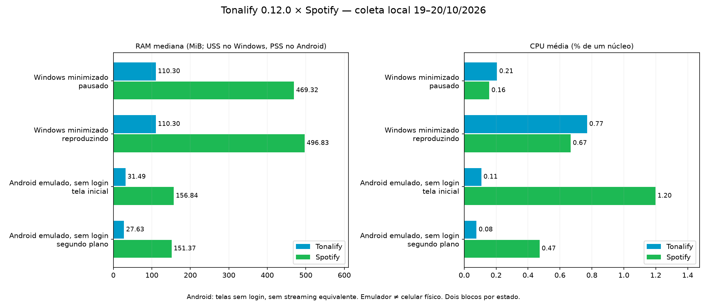

# Tonal Hub · Tonalify · IndieTonal

Player pessoal para **Windows e Android**, com catálogo Spotify no Tonalify,
fontes independentes no IndieTonal e uma biblioteca pessoal de favoritos,
playlists, estatísticas, letras e apresentação visual.

Este projeto deriva do **Tonal**, criado por **Matheus Nunes (natheus)**,
irmão de Maicon Nunes: [natheus/tonal-player](https://github.com/natheus/tonal-player).
A base original C++/Qt e a integração inicial Spotify são de Matheus. As
extensões deste fork preservam os [créditos](CREDITS.md) e a [licença MIT](LICENSE).
As entregas pessoais não são releases oficiais do projeto original ou do Spotify.

**Produto atual: Windows 0.15.0 · Android 0.15.0. Documentação consolidada em 24/10/2026.**

[Guia visual com capturas](docs/GUIA_VISUAL.md) ·
[Regras da Descoberta 2+1](docs/DESCOBERTA_2_MAIS_1.md) ·
[Benchmarks realizados](docs/BENCHMARKS.md) ·
[Contexto do projeto](contexto.md) · [Instruções de manutenção](AGENTS.md).

## Estatísticas e histórias 0.15.0

Estatísticas e backup ficam sempre no topo. Seu ritmo cobre de uma semana a
**Desde o começo**, com histórico SQLite sem expiração de 180 dias e tamanho
real da biblioteca/último backup no rodapé. O card de histórias pode interpretar
até oito letras do período com **Qwen2.5 0.5B + llama.cpp**, inteiramente local.
O modelo aberto é opcional (468,6 MiB), carregado somente durante a análise em
processo separado. Não avalia seu humor ou saúde.

[Como usar, limites e validação](docs/STATISTICS_STORIES_0150.md) ·
[Proveniência e licenças](third_party/LOCAL-STORIES.md).

## Correção Windows 0.14.1

O volume acompanha o arraste, sem esperar soltar. Comandos são agrupados e
serializados por dispositivo; respostas antigas não puxam a barra de volta.
Roda do mouse: dois pontos percentuais por passo, respeitando o delta e
acumulando movimentos finos. O percentual aparece ao apontar/arrastar.
[Detalhes e validação](docs/VOLUME_WINDOWS_0141.md). Android permanece 0.14.0.
Validação complementar: **CTest Windows 10/10**, além dos 10 cenários de
volume, QML 20/20 e runtime dos três programas. Tentativas iniciais e limites
permanecem no [relatório](docs/volume-windows-0141-tests.json).

## Novidades 0.14.0

A página da música tem três seções que ocupam a área disponível: **Música,
Letra e Artista**, com navegação vertical e atalhos. Compartilhe o link Spotify
com um cartão de capa, cores e estilos personalizados. Fatos do MusicBrainz
com fonte identificada e sugestões editoriais por estilo completam a seção Artista.
No Android, **Criar playlist → Criar com setlist.fm** importa shows para a revisão
nativa do Text to Tonalify, com chave própria guardada no Android Keystore.
[Guia e limites](docs/SONG_PAGES_SHARE_SETLISTS_0140.md).

## Novidades 0.13.3

No Android, trocar o tema muda o ícone sem fechar o Tonalify; a música e a
tela continuam. [Detalhes](docs/NOTIFICACAO_ICONE_0132.md#0133-trocar-o-tema-sem-fechar-o-app).

## Novidades 0.13.2

A notificação do Android mostra a **capa do álbum, a música e a banda**, com a
barra de posição real. O **ícone** do app acompanha o tema: na tela inicial e
na notificação do Android e na janela/barra de tarefas do PC.
[Detalhes](docs/NOTIFICACAO_ICONE_0132.md).

## Novidades 0.13.1

Todos os controles ficam juntos da barra de progresso: **Shake, Aleatório,
anterior, tocar, próxima, Repetir e Descoberta 2+1**. No PC, os modos passam
a valer na hora para a fila atual, sem recomeçar a música, e o painel Fila
mostra a nova ordem. A **repetição** (fila ou uma faixa) agora funciona no PC
e chegou ao Android. [O que mudou e por quê](docs/REPETICAO_MODOS_0131.md).

## Novidades 0.13.0

Seis **temas** no PC e no celular, com os mesmos nomes: Tonal Azul, Aurora,
Pôr do sol, Neon, Oceano e Grafite suave. Cada um muda as cores e também a
barra de progresso e o marcador dela (anel, pílula, losango, halo, barra maior
para o toque). Escolha em **Conta → Temas**; vale na hora, sem parar a música.

**Aplicar e reproduzir fila** com Descoberta 2+1, Shake ou Aleatório não
recarrega mais a música atual no Android; no PC, o ajuste acontece na posição
em que o áudio já está. **Seek** fluido: a barra não volta sozinha e o PC envia
um único pedido ao soltar. [Causas, correções e limites](docs/TEMAS_SEEK_FILA_0130.md).

## Novidades 0.12.0

Descoberta 2+1 preservada ao usar Shake/Aleatório e ao reabrir a fila.
Busca automática de letras das candidatas, com análise local, cache limitado
e opção de desligar. A fila confirmada não muda durante a análise.
BPM, timbre e tonalidade ainda não são extraídos.
[Funcionamento e limites](docs/DISCOVERY_ENRICHMENT_0120.md).

## O que cada aplicativo faz

| Aplicativo | Função |
|---|---|
| **Tonal Hub** | Central para abrir e alternar os players; no Windows, mantém processos separados e não inicializa o motor de áudio no hub |
| **Tonalify** | Busca, biblioteca, artistas, álbuns, playlists e streaming Spotify por Web API/librespot, com sessão autorizada |
| **IndieTonal** | Busca e reprodução de conteúdo público de fontes independentes e bibliotecas próprias, com procedência identificada |

Windows usa **C++20 e Qt Quick/QML**, sem Electron ou navegador embutido.
Android usa interface **Java nativa**, regras/DSP **C++ por JNI** e o motor
**Rust/librespot** existente, com saída AudioTrack. Não há React/WebView no
Text to Tonalify, que foi portado para C++ compartilhado.

## Veja as funções

<table>
<tr><th>Windows: modos de reprodução</th><th>Android: página da música</th></tr>
<tr><td></td><td></td></tr>
</table>

Capturas reais de validação **0.11.0, com dados sintéticos**; não são novas
capturas dos binários 0.11.1. A capa ausente é intencional nas fixtures.
O [guia visual](docs/GUIA_VISUAL.md) também mostra capas reais, artistas,
letras/tradução, fila, playlists por texto, estatísticas, raridades e áudio,
com versão e origem de cada imagem.

## Funcionalidades implementadas

| Área | Recursos e como acessar |
|---|---|
| **Catálogo Spotify** | Início, busca com filtros e histórico recente, músicas, artistas, álbuns, playlists e biblioteca; páginas de artista e coleção |
| **Player e favoritos** | Play/pausa, anterior/próxima, posição, volume e coração azul preenchido; no celular, tocar no miniplayer abre a página da música |
| **Fila e modos** | Shake, Aleatório e Descoberta 2+1 junto da barra de progresso, aplicados direto à fila atual; janela Fila com prévia e Aplicar; descobertas identificadas |
| **Repetição** | Repetir a fila ou uma faixa no PC e no Android, mantida ao trocar de seleção |
| **Playlists** | Biblioteca pessoal local; criar/editar playlists Spotify e suas faixas conforme a API permite; assistente Text to Tonalify com revisão de versões, ordem, nome, descrição e capa |
| **Setlists no Windows e Android** | Buscar shows no setlist.fm e transformar músicas encontradas no Spotify numa playlist; exige chave própria setlist.fm |
| **Estatísticas** | Tempo realmente ouvido, escutas qualificadas e músicas distintas por artista, faixa, álbum, estilo e dia; barras clicáveis e resumos nas listas |
| **Clima do repertório** | Temas experimentais de letras, estilos, cobertura e sugestões editoriais; classificador local pequeno, sem diagnóstico emocional |
| **Letras e tradução** | Busca automática enquanto a página está aberta, tradução pt-BR com detecção de idioma, original/tradução juntos, TXT/LRC, sincronia opcional e alinhamento manual |
| **Temas** | Seis temas no PC e no Android, com barra de progresso e marcador próprios; Conta → Temas |
| **Personalização** | 11 cenários; fontes, cores e tamanhos independentes, contorno, brilho, neon, piscante, negrito, itálico, sublinhado e tela cheia |
| **Áudio** | Streaming Spotify 96/160/320 kbps, EQ 10 bandas e presets, graves, compressor, limiter, normalização, HRTF e arquivos IAMF compatíveis; perfis de saída/buffer no Android |
| **Continuidade** | Buffer/cache temporário, recuperação limitada de conexão/saída, preservação de posição e respeito à pausa; não equivale a downloads offline garantidos |
| **Dados e backup** | SQLite pessoal por aparelho/player; exportar/restaurar favoritos, playlists, preferências e histórico; backup privado de fontes/instaláveis/documentos |
| **Integração Windows** | Teclas de mídia, painel de mídia do Windows, Spotify Connect, atalhos e idiomas Português/English |

### Descoberta 2+1: compatibilidade e novidade

Prepara **duas faixas da seleção → uma externa**, sem alterar a playlist salva.
Gêneros em comum têm mais peso; proximidade do ano e temas já analisados podem
contribuir. Artista e faixa inéditos no histórico local recebem multiplicador
16; artista conhecido/faixa inédita, 2; ambos conhecidos, 1.

É sorteio ponderado entre candidatos de páginas limitadas de busca, sem
promessa de nunca repetir. Busca letras do lote em segundo plano e reutiliza os
temas em preparações futuras; a cobertura depende do LRCLIB. Não extrai BPM,
timbre ou tonalidade. Shake e Aleatório preservam as descobertas aceitas.
Até 120 candidatos; fila até 500 entradas; se as originais ocupam todas as
posições, extras não cabem. Preparação: 15 s Windows e 6,5 s Android.

[Leia as regras completas, fórmulas, filtros e diferenças entre plataformas](docs/DESCOBERTA_2_MAIS_1.md).

### Playlist a partir de texto, nativa

**Criar playlist → Criar com Text to Tonalify:** colar → revisar gravações →
personalizar → salvar local. Depois escolha se quer copiar para Spotify,
privada ou pública. A sessão existente é reaproveitada; capa pode exigir
permissão OAuth adicional. Não publica automaticamente ao colar ou salvar local.

Porta o projeto [PlaylistSpotify](https://github.com/mikerock12/PlaylistSpotify)
para C++ compartilhado, sem React ou servidor JavaScript.
[Guia completo](docs/TEXT_TO_TONALIFY_090.md).

### Fontes do IndieTonal

| Fonte | Conteúdo | Condição |
|---|---|---|
| Audius | Faixas, artistas e coleções públicas | Conteúdo gated não oferece play |
| Internet Archive / Live Music Archive / Aadam Jacobs | Shows, gravações de fãs, raridades e demos disponíveis | Acervo e formatos públicos variam; itens restritos são recusados |
| MusicBrainz | Artistas, discografia, lançamentos e faixas | **Somente metadados**, sem áudio |
| Jamendo | Busca e streaming oferecido pela API | Client ID próprio ativo; sem credencial emprestada |
| OpenSubsonic | Biblioteca própria, inclusive conteúdo adquirido/importado pelo usuário | Servidor HTTPS, conta e credencial próprios |
| Arquivos locais | Arquivos compatíveis com os decoders incluídos | Sem login Spotify |

Jamendo/OpenSubsonic configuráveis não equivalem a validação autenticada com
uma conta real. Nenhuma fonte garante shows de toda banda. Não há agregação
universal de áudio nem sincronização bidirecional entre serviços.
[Fontes e raridades](docs/RARE_RECORDINGS_LOCAL.md) · [Hub](docs/TONAL_HUB_LOCAL.md).

## Desempenho: números medidos, com escopo

**Nova coleta 0.12.0, 19–20/10/2026**, contra os clientes oficiais instalados:
Spotify Windows 1.3.5.3058 e Android 9.1.90.2270.

| Plataforma/cenário | Tonalify: RAM mediana / CPU média | Spotify: RAM mediana / CPU média |
|---|---:|---:|
| Windows minimizado, mesma faixa reproduzindo | **110,30 MiB USS / 0,77%** | 496,83 MiB USS / 0,67% |
| Windows minimizado, pausado | 110,30 MiB USS / 0,21% | 469,32 MiB USS / 0,16% |
| Android emulado, sem login, tela inicial + Hub | **31,49 MiB PSS / 0,11%** | 156,84 MiB PSS / 1,20% |
| Android emulado, sem login, segundo plano + Hub | 27,63 MiB PSS / 0,08% | 151,37 MiB PSS / 0,47% |

CPU 100% = um núcleo. Processos auxiliares estão incluídos. USS e PSS são
métricas diferentes. PC i5-6500/16 GB/Windows 10; AVD Android 16 x86_64.
No Windows minimizado tocando, RAM foi **77,80% menor nessa amostra**. Não houve
vantagem consistente de CPU: a direção mudou entre as duas rodadas. DSP e
qualidade do Spotify não foram igualados; Tonalify manteve EQ, graves e
normalização pessoais ativos. Rodadas curtas não sustentam vantagem universal.

**Não há streaming autenticado equivalente do Spotify Android nessa medição.**
O login oficial retornou “Something went wrong” mesmo com código novo
fornecido pelo usuário e uma repetição. A tela sem login não prova economia
durante reprodução. Não foram medidos bateria,
latência acústica ou qualidade Bluetooth no POCO X7 Pro. Animações têm custo real.

Suplemento Tonalify tocando no Android, medido separadamente: **72,73 MiB PSS /
4,69% de um núcleo**, zero novos underruns nas duas janelas. Player de teste
depurável, sem Hub; não comparar esse número ao Spotify sem login.

[Resultados, gráficos e rodadas 0.12.0](docs/benchmarks/2026-10-19/RESULTADOS.md) ·
[Método e funcionalidades](docs/BENCHMARK_0120.md) ·
[JSON](docs/benchmarks/2026-10-19/summary.json) · [CSV](docs/benchmarks/2026-10-19/samples.csv) ·
[Índice e medições históricas](docs/BENCHMARKS.md).



## Instalar a correção Windows 0.14.1

[Instalador privado Windows x64](https://drive.google.com/file/d/1mDaepCI5yVEVmrVBrvBw9ekfxaPHqyij/view)
— `out/release-local/Tonal-Hub-0.14.1.0-Windows-x64-Setup.exe`.
Feche os players e instale por cima; dados ficam separados dos executáveis.
Android permanece na entrega 0.14.0 abaixo.
[Validação e limites](docs/volume-windows-0141-tests.json) ·
[Backup privado 0.14.1](https://drive.google.com/drive/folders/1X5iQCZHdaGoflbjW2B9H4h_XEAtcSqqb).

## Instalar a entrega pessoal 0.14.0

| Plataforma | Arquivo local | Download privado |
|---|---|---|
| Windows x64 | `out/release-local/Tonal-Hub-0.14.0.0-Windows-x64-Setup.exe` | [Instalador](https://drive.google.com/file/d/18R2dKi_sQrA9WKpw26ZPq-MC15f9uMw7/view) |
| POCO X7 Pro / ARM64 | `out/android/Tonal-Android-0.14.0-arm64-v8a.apk` | [APK ARM64](https://drive.google.com/file/d/1WhvDGgmFMvLfrtoXKNTm-zynFJI_xrBD/view) |
| ARM64 + emulador x86_64 | `out/android/Tonal-Android-0.14.0-local.apk` | [APK universal](https://drive.google.com/file/d/1ih2ptr1HcbkUedtH1ymwOQfE0a-4UM1q/view) |

Atualize por cima da versão anterior. Android versionCode 19 e mesma assinatura
0.13.3; bibliotecas de áudio nativas idênticas. Os três programas Windows foram
abertos com o runtime do pacote em smoke offscreen; não houve teste de instalação
interativa. [Guia da versão](docs/SONG_PAGES_SHARE_SETLISTS_0140.md) e
[backup privado 0.14](https://drive.google.com/drive/folders/1iztlSwSWiDcCk5A6Wd1XIBHlJRGzEae4).

## Instalar a entrega pessoal 0.13.3

| Plataforma | Arquivo local | Download privado |
|---|---|---|
| Windows x64 | `out/release-local/Tonal-Hub-0.13.3.0-Windows-x64-Setup.exe` | [Instalador](https://drive.google.com/file/d/1kVLwonfkXs54YQlwVGlC5rbLT2wT_7ZW/view) |
| POCO X7 Pro / ARM64 | `out/android/Tonal-Android-0.13.3-arm64-v8a.apk` | [APK ARM64](https://drive.google.com/file/d/1A1dW24RqdHI6I_8GILAENqGlUtDPvT81/view) |
| ARM64 + emulador x86_64 | `out/android/Tonal-Android-0.13.3-local.apk` | [APK universal](https://drive.google.com/file/d/1cp_VX3bz7xz6oaIdbNuFjfGp82RqU4at/view) |

[Pacote e backup privado 0.13.3](https://drive.google.com/drive/folders/1QgE4Ja6iKKczifxhrirB-Dx9AJ3fTTqZ).
Acesso restrito ao proprietário. Mesma assinatura Android: instale por cima para manter os dados.

### Entrega anterior 0.13.2

| Plataforma | Arquivo local | Download privado |
|---|---|---|
| Windows x64 | `out/release-local/Tonal-Hub-0.13.2.0-Windows-x64-Setup.exe` | [Instalador](https://drive.google.com/file/d/1fb_llCK1VUkzRtO3iiL24T4iQEBrYutq/view) |
| POCO X7 Pro / ARM64 | `out/android/Tonal-Android-0.13.2-arm64-v8a.apk` | [APK ARM64](https://drive.google.com/file/d/1V65PenzYxXzVjf4A-nWjiNqEdUK8YHko/view) |
| ARM64 + emulador x86_64 | `out/android/Tonal-Android-0.13.2-local.apk` | [APK universal](https://drive.google.com/file/d/1j8HgrOU7v3UcXv0Xf-qzSp6-rlRwyQZX/view) |

[Pacote e backup privado 0.13.2](https://drive.google.com/drive/folders/1nW93Tq55vdBJcCv2pGtYjJNUgHvrSl99).
Acesso restrito ao proprietário. [Mudanças e testes](docs/NOTIFICACAO_ICONE_0132.md).
Mesma assinatura Android: instale por cima para manter os dados.

### Entrega anterior 0.13.1

| Plataforma | Arquivo local | Download privado |
|---|---|---|
| Windows x64 | `out/release-local/Tonal-Hub-0.13.1.0-Windows-x64-Setup.exe` | [Instalador](https://drive.google.com/file/d/1ARscw7fzIt3SlviGOzJ9LwHq1MqGGjum/view) |
| POCO X7 Pro / ARM64 | `out/android/Tonal-Android-0.13.1-arm64-v8a.apk` | [APK ARM64](https://drive.google.com/file/d/1G3BigRKzdVl4_4aiEvINH0RjVtVtdCy6/view) |
| ARM64 + emulador x86_64 | `out/android/Tonal-Android-0.13.1-local.apk` | [APK universal](https://drive.google.com/file/d/1ZFc4wvYQTXSyrU_7pO1dRDiA5fxA_SCb/view) |

[Pacote e backup privado 0.13.1](https://drive.google.com/drive/folders/12L0IbCaTwURRIcOoHaQMLcgVYnP3nMcV).
Acesso restrito ao proprietário. [Mudanças e testes](docs/REPETICAO_MODOS_0131.md).
Mesma assinatura Android: instale por cima para manter os dados.

### Entrega anterior 0.13.0

| Plataforma | Arquivo local | Download privado |
|---|---|---|
| Windows x64 | `out/release-local/Tonal-Hub-0.13.0.0-Windows-x64-Setup.exe` | [Instalador](https://drive.google.com/file/d/1XxI7mDI73Q_0Qh-zycogL_HnSvoRmJz8/view) |
| POCO X7 Pro / ARM64 | `out/android/Tonal-Android-0.13.0-arm64-v8a.apk` | [APK ARM64](https://drive.google.com/file/d/1gUuEMQc60heZAtPVFXibnSXFcarCoY10/view) |
| ARM64 + emulador x86_64 | `out/android/Tonal-Android-0.13.0-local.apk` | [APK universal](https://drive.google.com/file/d/1DgLz3vVf_vTQhCsRz-Xd_W9pk86XxxZX/view) |

[Pacote e backup privado 0.13.0](https://drive.google.com/drive/folders/1BR5bH6HQxCGUKrB0YAAMXTzp0ZQ0JBiI).
Acesso restrito ao proprietário. [Mudanças e testes](docs/TEMAS_SEEK_FILA_0130.md).
Mesma assinatura Android da 0.12.0: instale por cima para manter os dados.

### Entrega anterior 0.12.0

| Plataforma | Arquivo local | Download privado |
|---|---|---|
| Windows x64 | `out/release-local/Tonal-Hub-0.12.0.0-Windows-x64-Setup.exe` | [Instalador](https://drive.google.com/file/d/1zpXGG0ur089T4LiN68Fop9cjFeUsh2Vr/view) |
| POCO X7 Pro / ARM64 | `out/android/Tonal-Android-0.12.0-arm64-v8a.apk` | [APK ARM64](https://drive.google.com/file/d/15qz-5SYsuuQwwvkAW444NvrLstuAHIQo/view) |
| ARM64 + emulador x86_64 | `out/android/Tonal-Android-0.12.0-local.apk` | [APK universal](https://drive.google.com/file/d/1_2r5T0dIxxuvQD63a97hEL02iKZkKvlh/view) |

[Pacote e backup privado 0.12.0](https://drive.google.com/drive/folders/15bxn_XcZianWzzp9E5GdYI8deVqm1fy5).
Acesso restrito ao proprietário. [Mudanças e testes](docs/DISCOVERY_ENRICHMENT_0120.md).
As duas variantes Android têm os mesmos recursos; ARM64 é a menor para o POCO.

### Entrega anterior 0.11.1

| Destino | Arquivo local | Download no Drive privado |
|---|---|---|
| Windows x64 | `out/release-local/Tonal-Hub-0.11.1.0-Windows-x64-Setup.exe` | [Instalador](https://drive.google.com/file/d/1gzUJxmMUepI8se8KwSyOVmIRUpUd9Q_q/view) |
| POCO X7 Pro / ARM64 | `out/android/Tonal-Android-0.11.1-arm64-v8a.apk` | [APK ARM64](https://drive.google.com/file/d/1R-v2A1TstPsquKmq2zwnT5mr2uDtHPv1/view) |
| ARM64 + emulador x86_64 | `out/android/Tonal-Android-0.11.1-local.apk` | [APK universal](https://drive.google.com/file/d/1riHy14ZoplEntv9HS4tSdQYKvTQmrgIG/view) |

Instale por cima da anterior para preservar dados; exporte backup antes.
Universal tem os mesmos recursos e inclui outra arquitetura, por isso é maior.
Windows instala Tonal Hub, Tonalify e IndieTonal. O código deste fork é público por autorização do titular. Os links de
instaláveis exigem acesso ao Drive privado; não são releases do upstream. Veja [instalador](docs/WINDOWS_INSTALLER_LOCAL.md)
e [Android](docs/ANDROID_LOCAL.md) para configuração/build. Streaming Spotify
requer conta autorizada/Premium; arquivos locais e fontes independentes seguem
suas próprias condições.

No Windows, o login utiliza OAuth PKCE e Credential Manager. O guia de login
solicita Client ID próprio, sem Client Secret. Callback desktop:
`http://127.0.0.1:8898/callback`. Credenciais não entram no Git ou backup.

### Correções 0.11.1 e evidências

- **PC:** fila atual antes da prévia, recuperação de contexto álbum/playlist
  quando disponível, metadados preservados e mensagens claras de falha.
  Refresh da mesma música não cancela preparação; troca real invalida a prévia.
- **Android:** protege contra PCM/retomadas sem intenção de tocar, callbacks
  tardios e seleção iniciada em segundo plano. Pausa cancela recuperação.
  Retomar por Bluetooth/tela bloqueada após pausa exige a opção em Áudio;
  música já iniciada continua quando a tela é bloqueada.
- **Validação:** dez CTest Windows; QML oito fila/seis letras/três playlist;
  16 verificações Android host e 21 cenários dirigidos no emulador. A suíte
  ampla inicial teve timeout de persistência; não foi toda aprovada.
- **Instaláveis:** upgrade preservando dados e abertura sem SDK; APKs Release
  com assinatura compatível, ABI, CRC e alinhamento de 16 KiB conferidos.

[Correções](docs/DISCOVERY_PLAYBACK_0111.md) · [Registro dos testes](docs/discovery-playback-0111-tests.json).
Nenhum novo benchmark foi executado nessa entrega. A causa exata dos dois
inícios espontâneos relatados no telefone não foi reproduzida fisicamente.

## Dados, letras e áudio: limites práticos

Favoritos, estatísticas, playlists pessoais e personalizações ficam no SQLite
local de cada player/aparelho. Não há sincronização automática PC/celular.
Use **Backup → Exportar/Restaurar** para guardar os dados fora do app.
Desinstalar pode apagá-los; login Spotify não restaura a biblioteca pessoal local.

Letras vêm do LRCLIB/importação e tradução do Google Tradutor. Quando traduz,
o texto é enviado ao serviço. A análise TonalMuse é local: classificador C++
int8 de 32.832 bytes, corpus sintético PT/EN/ES, sem LLM ou precisão demonstrada
em letras reais. Expõe cobertura e pode abster-se. Não diagnostica humor/saúde.
[Modelo e medições](docs/TONAL_MUSE_070.md).

HRTF é processamento binaural; IAMF depende de fonte IAMF compatível e não
converte Spotify estéreo em Atmos. Bluetooth é negociado pelo Android/receptor:
o app não força codec privilegiado. Buffer temporário não é download offline
permanente. EQ/mais volume não comprovam fidelidade superior.
[Áudio Android e testes](docs/ANDROID_AUDIO_LOCAL.md) · [Áudio desktop](docs/AUDIO_LOCAL.md).

## Build, testes e manutenção

Windows: Visual Studio C++, Qt 6.8.3 MSVC 2022, CMake/Ninja e dependências
fixadas em `third_party/`; Rust para librespot. Em Developer PowerShell:

```powershell
cmake --preset release
cmake --build --preset release
.\out\build\release\Tonal.exe
```

O executável de build mantém o nome Tonal.exe; o pacote pessoal usa Tonalify.exe.
Consulte os roteiros em `packaging/` e os guias de áudio/instalador antes de
empacotar, porque o release simples do upstream não equivale ao hub completo.

Android: JDK 17, Gradle 8.14.3, SDK 36 e NDK 27.0.12077973. O script
`packaging/build-android-local.ps1` gera universal; `-PhoneOnly` gera ARM64.
`-SkipNative -SkipAudio` reutiliza bibliotecas já compiladas compatíveis.

O [CI do projeto](.github/workflows/ci.yml) reproduz o modelo, compila/testa o
núcleo C++, verifica QML, política de reprodução e variantes Java Android.
Testes não medem automaticamente CPU/RAM ou Bluetooth real.

- [Contexto e estado da entrega](contexto.md).
- [Regras para manutenção](AGENTS.md).
- [Histórico de mudanças](CHANGELOG.md).
- [Backup completo privado](https://drive.google.com/drive/folders/1sNjL35fdHzoLY8QcqtBX2XF4YQJbeKlL).

O backup guarda fontes versionadas, histórico Git, instaláveis, fontes de áudio
correspondentes, documentos e dados pessoais disponíveis do PC. Exclui tokens,
Vault, senhas, assinatura privada, mídia externa e banco do telefone físico.
As instruções de restauração acompanham o pacote.

## Licenças e origem

Código derivado sob [MIT](LICENSE), com autoria original de **Matheus Nunes
(natheus)** preservada. Dependências têm licenças próprias distribuídas nos
pacotes: Qt, librespot, FFmpeg, OpenAL Soft, libiamf e outras; veja
[avisos de áudio](third_party/AUDIO-NOTICES.md) e [créditos](CREDITS.md).
Capas, fotos, letras e gravações pertencem aos respectivos titulares.
Projeto pessoal não oficial, sem afiliação com Spotify AB.
