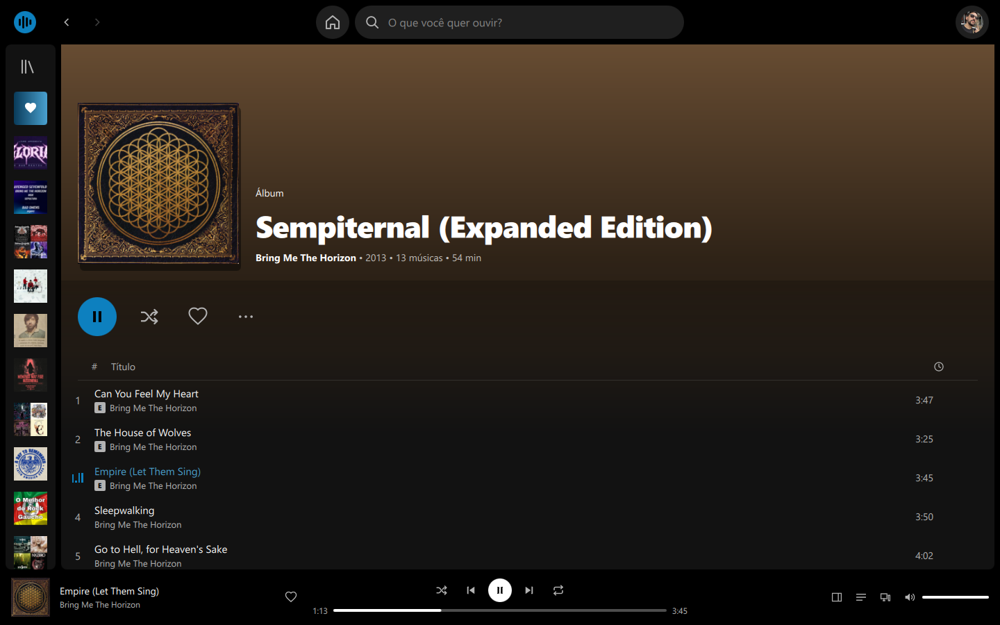
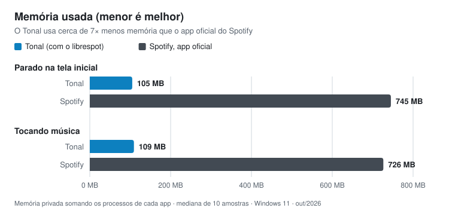

# Tonal

Player leve para **Spotify Premium** no Windows, feito em **C++ e Qt Quick**, com o áudio tocado pelo
**[librespot](https://github.com/librespot-org/librespot)**. Sem Electron, sem Chromium embutido.



## Leve de verdade

<picture>
  <source media="(prefers-color-scheme: dark)" srcset="docs/memoria-escuro.svg">
  
</picture>

| | Parado na tela inicial | Tocando música | Processos |
|---|---:|---:|---:|
| **Tonal 0.1.0** (Tonal + librespot) | **105 MB** | **109 MB** | 2 |
| Spotify 1.303 para Windows (Microsoft Store) | 745 MB | 726 MB | 8 |

Como medi: memória privada (a coluna "Memória" do Gerenciador de Tarefas), somando todos os processos de cada
app; mediana de 10 amostras, 1 minuto depois de abrir e 45 segundos depois de dar play na mesma playlist.
Windows 11, outubro de 2026. Os valores mudam de máquina para máquina e com o uso.

## O que ele faz

- **Início:** atalhos, tocadas recentemente, artistas e músicas mais ouvidas, suas playlists e álbuns salvos
- **Busca** com melhor resultado, músicas, artistas, álbuns e playlists, filtros, "carregar mais" e buscas recentes
- **Páginas** de playlist, álbum, Músicas Curtidas (com rolagem infinita) e artista (populares e discografia)
- **Sua Biblioteca** com filtros e busca, redimensionável e recolhível
- **Playlists:** criar, renomear, mudar a descrição, excluir, adicionar e remover músicas (menu de qualquer
  música) e arrastar as músicas para mudar a ordem
- **Player:** tocar/pausar, anterior/próxima, aleatório, repetir, barra de progresso, volume e curtir
- **Fila** e tela **Tocando agora** no painel direito
- **Letras sincronizadas:** a linha que está tocando fica em destaque, a letra acompanha a música e um clique
  numa linha pula para ela
- **Teclas de mídia** do teclado (mesmo com o Tonal minimizado) e a faixa com a capa no **painel de mídia do
  Windows**
- **Spotify Connect:** o Tonal aparece como dispositivo e também manda a música para o celular ou outro PC
- **Qualidade** 96/160/320 kbps e normalização de volume (menu da conta)
- **Atalhos:** `Espaço` tocar/pausar · `Ctrl+→/←` próxima/anterior · `Ctrl+↑/↓` volume · `Ctrl+L` busca ·
  `Alt+←/→` voltar/avançar · botões laterais do mouse
- **Motor de áudio que se recupera sozinho:** se a conexão com o Spotify cair, o Tonal reinicia o librespot e
  retoma a música do mesmo ponto

## Instalar

Baixe a versão mais recente em **[Releases](https://github.com/natheus/tonal-player/releases)**:

- `Tonal-<versão>-setup.exe`: instalador. Não precisa de administrador e cria atalho no Menu Iniciar.
- `Tonal-<versão>-win64.zip`: versão portátil. Descompacte e abra o `Tonal.exe`. Sem o atalho que o instalador
  cria no Menu Iniciar, o painel de mídia do Windows mostra "Aplicativo desconhecido" no lugar do nome.

Os dois já trazem tudo o que o app precisa (Qt, runtime do Visual C++ e librespot).

**Requisitos:** Windows 10 (1809) ou 11, 64 bits, e uma conta **Spotify Premium**.

O executável não é assinado digitalmente: se o SmartScreen avisar, clique em
**Mais informações → Executar assim mesmo**.

## Primeiro uso

O Tonal usa a Web API oficial do Spotify, e para isso cada pessoa cria um app gratuito no painel de
desenvolvedor do Spotify. A tela de login guia tudo, com botões para abrir o formulário e copiar cada campo:

1. Abra o formulário **Create app** em <https://developer.spotify.com/dashboard/create>.
2. Preencha nome e descrição, adicione em **Redirect URIs** exatamente `http://127.0.0.1:8898/callback`
   (clique em **Add**), marque **Web API**, aceite os termos e clique em **Save**.
3. Copie o **Client ID** do app. Ao voltar para o Tonal ele é colado sozinho e conferido com o Spotify antes de
   abrir o navegador. O Client Secret não é usado.

Na primeira vez abrem **duas** autorizações no navegador: a do Tonal (Web API) e a do librespot (o motor de
áudio). Depois disso fica tudo salvo e o app abre direto.

O login do Tonal fica no **Gerenciador de Credenciais do Windows**, como "Tonal/Spotify", cifrado pelo próprio
Windows para a sua conta (a versão 0.1.0 guardava no registro, e o Tonal muda para lá sozinho). "Sair", no menu
da conta, apaga a credencial.

## Limitações

Vêm das regras do Spotify para apps em modo de desenvolvimento (desde fevereiro de 2026), não do Tonal:

- **Playlists de outras pessoas** não mostram as faixas pela API. O Tonal avisa e deixa tocar mesmo assim.
- **Playlists geradas pelo Spotify** (Daily Mix e editoriais) não abrem pela API.
- A **busca** traz no máximo 10 itens por tipo (o "Carregar mais" pagina). Os **populares** de um artista vêm de
  uma busca e mostram até 5 faixas.
- Não há "Novos lançamentos" nem categorias: o Spotify tirou esses recursos da API.

As **letras** não vêm do Spotify, cuja API não tem letras, e sim do [LRCLIB](https://lrclib.net), um acervo aberto
mantido por voluntários: nem toda música está lá. Só com a tela de letra aberta o Tonal envia ao LRCLIB o nome
da música, do artista e do álbum e a duração.

A **visibilidade** de uma playlist (pública ou privada) só muda pelo app oficial: a API aceita tornar uma
playlist pública, mas ignora o pedido de voltar para privada. As playlists criadas pelo Tonal nascem privadas.

Além disso, por enquanto o Tonal só foi feito e testado no Windows.

## Como funciona

```
┌──────────────────────── Tonal.exe (Qt Quick) ────────────────────────┐
│  QML (interface)  ──►  C++ (App, Player, SpotifyApi, AuthManager)    │
│                              │ Web API (HTTPS)                       │
│                              ▼                                       │
│                     api.spotify.com  ◄── comandos: play, pause...    │
└──────────────────────────────┬───────────────────────────────────────┘
                               │ inicia e vigia o processo
                     librespot.exe  ──►  áudio (dispositivo "Tonal @ PC")
```

O Tonal fala com a Web API oficial (biblioteca, busca, controle). O librespot aparece como um dispositivo
Spotify Connect e é quem baixa e toca a música; o Tonal manda tocar nele.

Por que gasta pouco:

- Interface em Qt Quick desenhada pela GPU, sem motor de navegador
- Estilo "Basic" do Qt Quick Controls e ícones vetoriais com `QtQuick.Shapes` (sem PNGs nem fontes de ícones)
- Capas decodificadas no tamanho em que aparecem e guardadas em cache no disco
- Páginas criadas e destruídas sob demanda; listas longas reaproveitam as linhas
- O estado do player é consultado a cada 5 s e a barra de progresso anda sozinha; o log do librespot avisa na
  hora quando a faixa muda

## Compilar a partir do código

### 1. O que instalar (uma vez)

| O quê | Onde | Observação |
|---|---|---|
| Visual Studio 2022 ou 2026 | [visualstudio.microsoft.com](https://visualstudio.microsoft.com) | workload **Desenvolvimento para desktop com C++** (traz CMake e Ninja) |
| Qt 6.8 ou mais novo | [Qt Online Installer](https://www.qt.io/download-qt-installer-oss) | marque **MSVC 2022 64-bit** e, em *Additional Libraries*, **Qt Image Formats** (as capas de playlist vêm em WebP) |
| Rust | [rustup.rs](https://rustup.rs) | só para compilar o librespot |

Depois de instalar o Qt, crie a variável de ambiente `QTDIR` apontando para o kit, por exemplo:

```powershell
setx QTDIR "C:\Qt\6.8.3\msvc2022_64"
```

Feche e abra o Visual Studio (ou o terminal) depois do `setx`.

### 2. Compilar o librespot

```powershell
cargo install librespot --locked
```

O executável fica em `%USERPROFILE%\.cargo\bin\librespot.exe`. O Tonal procura nesta ordem: ao lado do
`Tonal.exe`, no `PATH` e em `.cargo\bin`. Não precisa copiar nada.

### 3. Compilar o Tonal

**Pelo Visual Studio:** *Arquivo → Abrir → Pasta...* e escolha esta pasta. Na barra de cima escolha o preset
**Release (MSVC + Qt)**, depois *Compilar → Compilar Tudo* e rode `Tonal.exe`. O `windeployqt` roda sozinho
depois do build e copia as DLLs do Qt para a pasta do executável.

**Pela linha de comando** (Developer PowerShell do Visual Studio):

```powershell
cmake --preset release
cmake --build --preset release
.\out\build\release\Tonal.exe
```

### 4. Gerar uma release

Com o Inno Setup 6 instalado (`winget install JRSoftware.InnoSetup`), num PowerShell comum:

```powershell
.\packaging\release.ps1             # gera em out\release\: ZIP, instalador e SHA256SUMS.txt
.\packaging\release.ps1 -Publish    # gera e publica a release v<versão> no GitHub (precisa do gh logado)
```

A versão vem do `project(Tonal VERSION ...)` do `CMakeLists.txt`. Antes de cada release nova, suba a versão e
escreva as novidades dela no [CHANGELOG.md](CHANGELOG.md): o `-Publish` copia essa seção para a página da release.

### Estrutura

```
src/
  main.cpp              inicializa app, estilo, fonte e o motor QML
  App.*                 singleton exposto ao QML (App.auth, App.api, App.player, App.librespot)
  AuthManager.*         OAuth PKCE + servidor de callback em 127.0.0.1:8898
  SpotifyApi.*          cliente HTTP da Web API (401 → refresh, 429 → Retry-After)
  Player.*              estado de reprodução, comandos, fila, dispositivos
  LibrespotProcess.*    inicia/reinicia o librespot, lê o log, Job Object no Windows
  MediaControls.*       teclas de mídia e painel de mídia do Windows (SMTC)
  Lyrics.*              letras do LRCLIB: busca, escolha da versão certa e leitura do formato LRC
  NetworkFactory.*      cache em disco para as capas
qml/
  Main.qml              janela, layout, navegação, atalhos, menu de faixa, toast
  Theme.qml             cores (azul, preto e branco), medidas e funções de formatação
  Icons.qml             paths SVG dos ícones
  Nav.qml               histórico de navegação e estado compartilhado
  Playlists.qml         criar e editar playlists (e a permissão que isso pede ao Spotify)
  components/           Icon, Cover, MediaCard, TrackRow, SeekBar, Chip...
  panels/               TopBar, LibraryPanel, PlayerBar, RightPanel, DevicePopup
  pages/                Login, Home, Search, Collection (playlist/álbum/curtidas), Artist, Lyrics
resources/
  tonal.ico             ícone do app (gerado por make-icon.ps1, ligado ao .exe pelo tonal.rc)
packaging/
  release.ps1           gera o ZIP portátil e o instalador (e publica a release com -Publish)
  tonal.iss             instalador (Inno Setup 6)
  licenses/             licenças do Qt e do librespot, que vão junto na release
docs/                   imagens deste README
```

## Próximos passos

- Capa personalizada de playlist e arrastar músicas direto para uma playlist de Sua Biblioteca
- Assinar o executável e testar em Linux e macOS

## Licença

O código do Tonal está sob a [licença MIT](LICENSE).

Os pacotes de release também incluem o [Qt 6](https://www.qt.io) (LGPLv3, como bibliotecas dinâmicas) e o
[librespot](https://github.com/librespot-org/librespot) (MIT). As licenças deles vão na pasta `licenses` do pacote.

O Tonal é um cliente pessoal e não oficial. "Spotify" é marca da Spotify AB; este projeto não tem relação com a
empresa. O librespot é uma implementação aberta e não oficial do protocolo do Spotify.
