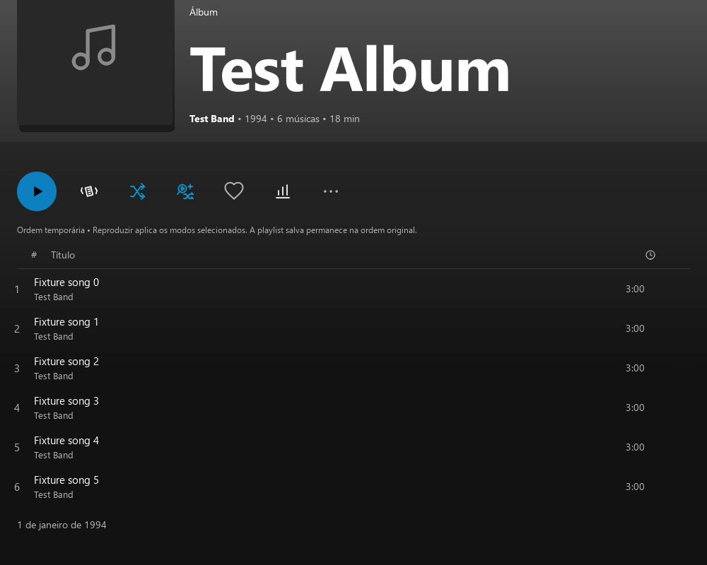
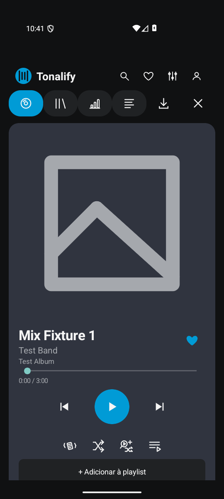

# Tonal Hub · Tonalify · IndieTonal

Player pessoal para **Windows e Android**, com catálogo Spotify no Tonalify,
fontes independentes no IndieTonal e uma biblioteca pessoal de favoritos,
playlists, estatísticas, letras e apresentação visual.

Este projeto deriva do **Tonal**, criado por **Matheus Nunes (natheus)**,
irmão de Maicon Nunes: [natheus/tonal-player](https://github.com/natheus/tonal-player).
A base original C++/Qt e a integração inicial Spotify são de Matheus. As
extensões deste fork preservam os [créditos](CREDITS.md) e a [licença MIT](LICENSE).
As entregas pessoais não são releases oficiais do projeto original ou do Spotify.

**Produto atual: 0.11.1. Documentação consolidada em 19/10/2026.**

[Guia visual com 16 capturas](docs/GUIA_VISUAL.md) ·
[Regras da Descoberta 2+1](docs/DESCOBERTA_2_MAIS_1.md) ·
[Benchmarks realizados](docs/BENCHMARKS.md) ·
[Contexto do projeto](contexto.md) · [Instruções de manutenção](AGENTS.md).

## O que cada aplicativo faz

| Aplicativo | Função |
|---|---|
| **Tonal Hub** | Central para abrir e alternar os players; no Windows, mantém processos separados e não inicializa o motor de áudio no hub |
| **Tonalify** | Busca, biblioteca, artistas, álbuns, playlists e streaming Spotify por Web API/librespot, com sessão autorizada |
| **IndieTonal** | Busca e reprodução de conteúdo público de fontes independentes e bibliotecas próprias, com procedência identificada |

Windows usa **C++20 e Qt Quick/QML**, sem Electron ou navegador embutido.
Android usa interface **Java nativa**, regras/DSP **C++ por JNI** e o motor
**Rust/librespot** existente, com saída AudioTrack. Não há React/WebView no
Text to Tonalify, que foi portado para C++ compartilhado.

## Veja as funções

<table>
<tr><th>Windows: modos de reprodução</th><th>Android: página da música</th></tr>
<tr><td></td><td></td></tr>
</table>

Capturas reais de validação **0.11.0, com dados sintéticos**; não são novas
capturas dos binários 0.11.1. A capa ausente é intencional nas fixtures.
O [guia visual](docs/GUIA_VISUAL.md) também mostra capas reais, artistas,
letras/tradução, fila, playlists por texto, estatísticas, raridades e áudio,
com versão e origem de cada imagem.

## Funcionalidades implementadas

| Área | Recursos e como acessar |
|---|---|
| **Catálogo Spotify** | Início, busca com filtros e histórico recente, músicas, artistas, álbuns, playlists e biblioteca; páginas de artista e coleção |
| **Player e favoritos** | Play/pausa, anterior/próxima, posição, volume e coração azul preenchido; no celular, tocar no miniplayer abre a página da música |
| **Fila e modos** | Shake visual, Aleatório de reprodução e Descoberta 2+1; prévia na página da música, identificação de descobertas e confirmação antes de aplicar |
| **Playlists** | Biblioteca pessoal local; criar/editar playlists Spotify e suas faixas conforme a API permite; assistente Text to Tonalify com revisão de versões, ordem, nome, descrição e capa |
| **Setlists no Windows** | Buscar shows no setlist.fm e transformar músicas encontradas no Spotify numa playlist; exige chave própria setlist.fm |
| **Estatísticas** | Tempo realmente ouvido, escutas qualificadas e músicas distintas por artista, faixa, álbum, estilo e dia; barras clicáveis e resumos nas listas |
| **Clima do repertório** | Temas experimentais de letras, estilos, cobertura e sugestões editoriais; classificador local pequeno, sem diagnóstico emocional |
| **Letras e tradução** | Busca automática enquanto a página está aberta, tradução pt-BR com detecção de idioma, original/tradução juntos, TXT/LRC, sincronia opcional e alinhamento manual |
| **Personalização** | 11 cenários; fontes, cores e tamanhos independentes, contorno, brilho, neon, piscante, negrito, itálico, sublinhado e tela cheia |
| **Áudio** | Streaming Spotify 96/160/320 kbps, EQ 10 bandas e presets, graves, compressor, limiter, normalização, HRTF e arquivos IAMF compatíveis; perfis de saída/buffer no Android |
| **Continuidade** | Buffer/cache temporário, recuperação limitada de conexão/saída, preservação de posição e respeito à pausa; não equivale a downloads offline garantidos |
| **Dados e backup** | SQLite pessoal por aparelho/player; exportar/restaurar favoritos, playlists, preferências e histórico; backup privado de fontes/instaláveis/documentos |
| **Integração Windows** | Teclas de mídia, painel de mídia do Windows, Spotify Connect, atalhos e idiomas Português/English |

### Descoberta 2+1: compatibilidade e novidade

Prepara **duas faixas da seleção → uma externa**, sem alterar a playlist salva.
Gêneros em comum têm mais peso; proximidade do ano e temas já analisados podem
contribuir. Artista e faixa inéditos no histórico local recebem multiplicador
16; artista conhecido/faixa inédita, 2; ambos conhecidos, 1.

É sorteio ponderado entre candidatos de páginas limitadas de busca, sem
promessa de nunca repetir. Não analisa BPM, timbre ou a letra de toda candidata.
Até 120 candidatos; fila até 500 entradas; se as originais ocupam todas as
posições, extras não cabem. Preparação: 15 s Windows e 6,5 s Android.

[Leia as regras completas, fórmulas, filtros e diferenças entre plataformas](docs/DESCOBERTA_2_MAIS_1.md).

### Playlist a partir de texto, nativa

**Criar playlist → Criar com Text to Tonalify:** colar → revisar gravações →
personalizar → salvar local. Depois escolha se quer copiar para Spotify,
privada ou pública. A sessão existente é reaproveitada; capa pode exigir
permissão OAuth adicional. Não publica automaticamente ao colar ou salvar local.

Porta o projeto [PlaylistSpotify](https://github.com/mikerock12/PlaylistSpotify)
para C++ compartilhado, sem React ou servidor JavaScript.
[Guia completo](docs/TEXT_TO_TONALIFY_090.md).

### Fontes do IndieTonal

| Fonte | Conteúdo | Condição |
|---|---|---|
| Audius | Faixas, artistas e coleções públicas | Conteúdo gated não oferece play |
| Internet Archive / Live Music Archive / Aadam Jacobs | Shows, gravações de fãs, raridades e demos disponíveis | Acervo e formatos públicos variam; itens restritos são recusados |
| MusicBrainz | Artistas, discografia, lançamentos e faixas | **Somente metadados**, sem áudio |
| Jamendo | Busca e streaming oferecido pela API | Client ID próprio ativo; sem credencial emprestada |
| OpenSubsonic | Biblioteca própria, inclusive conteúdo adquirido/importado pelo usuário | Servidor HTTPS, conta e credencial próprios |
| Arquivos locais | Arquivos compatíveis com os decoders incluídos | Sem login Spotify |

Jamendo/OpenSubsonic configuráveis não equivalem a validação autenticada com
uma conta real. Nenhuma fonte garante shows de toda banda. Não há agregação
universal de áudio nem sincronização bidirecional entre serviços.
[Fontes e raridades](docs/RARE_RECORDINGS_LOCAL.md) · [Hub](docs/TONAL_HUB_LOCAL.md).

## Desempenho: números medidos, com escopo

**Resultados históricos da versão 0.8, em 17/10/2026. Não são benchmark da 0.11.1.**

| Plataforma/cenário | Tonalify: RAM mediana / CPU média | Spotify: RAM mediana / CPU média |
|---|---:|---:|
| Windows, mesma faixa reproduzindo | **122,55 MiB USS / 0,50%** | 540,53 MiB USS / 2,87% |
| Windows, pausado | 122,65 MiB USS / 0,15% | 534,82 MiB USS / 0,43% |
| Android emulado, sem login, tela inicial | **16,99 MiB PSS / 0,06%** | 154,78 MiB PSS / 1,00% |

CPU 100% = um núcleo. Processos auxiliares estão incluídos. USS e PSS são
métricas diferentes. PC i5-6500/16 GB/Windows 10; AVD Android 16 x86_64.
No Windows tocando, RAM foi **77,33% menor nessa amostra**. Rodadas curtas,
configurações/visibilidade não integralmente igualadas e variação da CPU
impedem generalizar os percentuais para toda máquina ou uso.

**Não há streaming autenticado equivalente do Spotify Android nessa medição.**
Tonalify autenticado, coletado separadamente, ficou em 72,59 MiB PSS/5,23%,
sem base para declarar vantagem de reprodução. Não foram medidos bateria,
latência acústica ou qualidade Bluetooth no POCO X7 Pro. Animações têm custo real.

[Índice de todos os benchmarks 0.1/0.3/0.7/0.8](docs/BENCHMARKS.md) ·
[Relatório completo e comparação de funcionalidades](docs/BENCHMARK_080.md) ·
[Relatório HTML interativo: baixar/abrir](docs/benchmarks/2026-10-17/report.html) ·
[JSON](docs/benchmarks/2026-10-17/summary.json) · [CSV](docs/benchmarks/2026-10-17/samples.csv).

## Instalar a entrega pessoal 0.11.1

| Destino | Arquivo local | Download no Drive privado |
|---|---|---|
| Windows x64 | `out/release-local/Tonal-Hub-0.11.1.0-Windows-x64-Setup.exe` | [Instalador](https://drive.google.com/file/d/1gzUJxmMUepI8se8KwSyOVmIRUpUd9Q_q/view) |
| POCO X7 Pro / ARM64 | `out/android/Tonal-Android-0.11.1-arm64-v8a.apk` | [APK ARM64](https://drive.google.com/file/d/1R-v2A1TstPsquKmq2zwnT5mr2uDtHPv1/view) |
| ARM64 + emulador x86_64 | `out/android/Tonal-Android-0.11.1-local.apk` | [APK universal](https://drive.google.com/file/d/1riHy14ZoplEntv9HS4tSdQYKvTQmrgIG/view) |

Instale por cima da anterior para preservar dados; exporte backup antes.
Universal tem os mesmos recursos e inclui outra arquitetura, por isso é maior.
Windows instala Tonal Hub, Tonalify e IndieTonal. O código deste fork é público por autorização do titular. Os links de
instaláveis exigem acesso ao Drive privado; não são releases do upstream. Veja [instalador](docs/WINDOWS_INSTALLER_LOCAL.md)
e [Android](docs/ANDROID_LOCAL.md) para configuração/build. Streaming Spotify
requer conta autorizada/Premium; arquivos locais e fontes independentes seguem
suas próprias condições.

No Windows, o login utiliza OAuth PKCE e Credential Manager. O guia de login
solicita Client ID próprio, sem Client Secret. Callback desktop:
`http://127.0.0.1:8898/callback`. Credenciais não entram no Git ou backup.

### Correções 0.11.1 e evidências

- **PC:** fila atual antes da prévia, recuperação de contexto álbum/playlist
  quando disponível, metadados preservados e mensagens claras de falha.
  Refresh da mesma música não cancela preparação; troca real invalida a prévia.
- **Android:** protege contra PCM/retomadas sem intenção de tocar, callbacks
  tardios e seleção iniciada em segundo plano. Pausa cancela recuperação.
  Retomar por Bluetooth/tela bloqueada após pausa exige a opção em Áudio;
  música já iniciada continua quando a tela é bloqueada.
- **Validação:** dez CTest Windows; QML oito fila/seis letras/três playlist;
  16 verificações Android host e 21 cenários dirigidos no emulador. A suíte
  ampla inicial teve timeout de persistência; não foi toda aprovada.
- **Instaláveis:** upgrade preservando dados e abertura sem SDK; APKs Release
  com assinatura compatível, ABI, CRC e alinhamento de 16 KiB conferidos.

[Correções](docs/DISCOVERY_PLAYBACK_0111.md) · [Registro dos testes](docs/discovery-playback-0111-tests.json).
Nenhum novo benchmark foi executado nessa entrega. A causa exata dos dois
inícios espontâneos relatados no telefone não foi reproduzida fisicamente.

## Dados, letras e áudio: limites práticos

Favoritos, estatísticas, playlists pessoais e personalizações ficam no SQLite
local de cada player/aparelho. Não há sincronização automática PC/celular.
Use **Backup → Exportar/Restaurar** para guardar os dados fora do app.
Desinstalar pode apagá-los; login Spotify não restaura a biblioteca pessoal local.

Letras vêm do LRCLIB/importação e tradução do Google Tradutor. Quando traduz,
o texto é enviado ao serviço. A análise TonalMuse é local: classificador C++
int8 de 32.832 bytes, corpus sintético PT/EN/ES, sem LLM ou precisão demonstrada
em letras reais. Expõe cobertura e pode abster-se. Não diagnostica humor/saúde.
[Modelo e medições](docs/TONAL_MUSE_070.md).

HRTF é processamento binaural; IAMF depende de fonte IAMF compatível e não
converte Spotify estéreo em Atmos. Bluetooth é negociado pelo Android/receptor:
o app não força codec privilegiado. Buffer temporário não é download offline
permanente. EQ/mais volume não comprovam fidelidade superior.
[Áudio Android e testes](docs/ANDROID_AUDIO_LOCAL.md) · [Áudio desktop](docs/AUDIO_LOCAL.md).

## Build, testes e manutenção

Windows: Visual Studio C++, Qt 6.8.3 MSVC 2022, CMake/Ninja e dependências
fixadas em `third_party/`; Rust para librespot. Em Developer PowerShell:

```powershell
cmake --preset release
cmake --build --preset release
.\out\build\release\Tonal.exe
```

O executável de build mantém o nome Tonal.exe; o pacote pessoal usa Tonalify.exe.
Consulte os roteiros em `packaging/` e os guias de áudio/instalador antes de
empacotar, porque o release simples do upstream não equivale ao hub completo.

Android: JDK 17, Gradle 8.14.3, SDK 36 e NDK 27.0.12077973. O script
`packaging/build-android-local.ps1` gera universal; `-PhoneOnly` gera ARM64.
`-SkipNative -SkipAudio` reutiliza bibliotecas já compiladas compatíveis.

O [CI do projeto](.github/workflows/ci.yml) reproduz o modelo, compila/testa o
núcleo C++, verifica QML, política de reprodução e variantes Java Android.
Testes não medem automaticamente CPU/RAM ou Bluetooth real.

- [Contexto e estado da entrega](contexto.md).
- [Regras para manutenção](AGENTS.md).
- [Histórico de mudanças](CHANGELOG.md).
- [Backup completo privado](https://drive.google.com/drive/folders/1sNjL35fdHzoLY8QcqtBX2XF4YQJbeKlL).

O backup guarda fontes versionadas, histórico Git, instaláveis, fontes de áudio
correspondentes, documentos e dados pessoais disponíveis do PC. Exclui tokens,
Vault, senhas, assinatura privada, mídia externa e banco do telefone físico.
As instruções de restauração acompanham o pacote.

## Licenças e origem

Código derivado sob [MIT](LICENSE), com autoria original de **Matheus Nunes
(natheus)** preservada. Dependências têm licenças próprias distribuídas nos
pacotes: Qt, librespot, FFmpeg, OpenAL Soft, libiamf e outras; veja
[avisos de áudio](third_party/AUDIO-NOTICES.md) e [créditos](CREDITS.md).
Capas, fotos, letras e gravações pertencem aos respectivos titulares.
Projeto pessoal não oficial, sem afiliação com Spotify AB.
