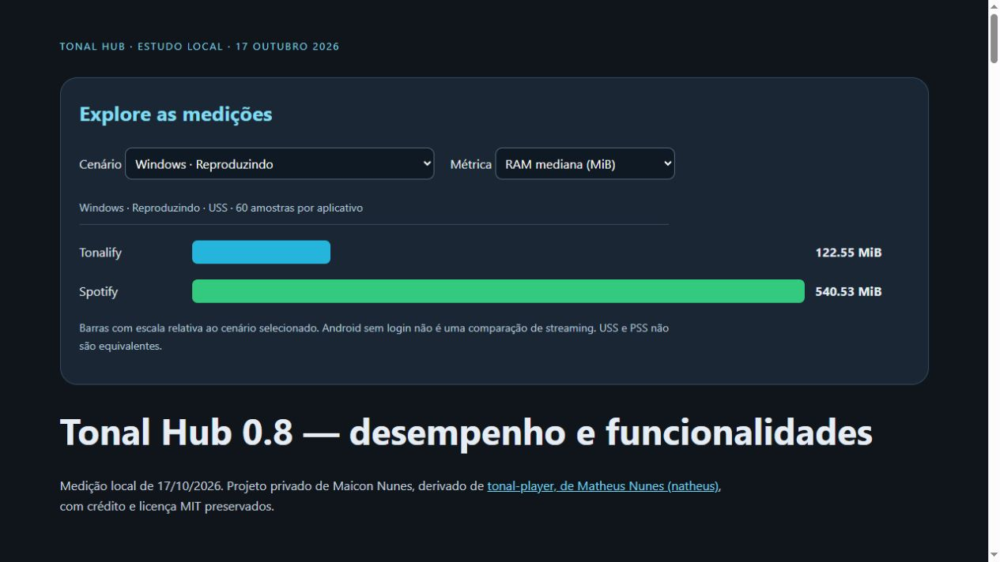

# Benchmarks realizados: histórico e limites

Consolidação documental em **19/10/2026**. Não houve nova coleta de CPU/RAM
para a versão 0.11.1. Os resultados abaixo preservam a versão, o ambiente e
o cenário em que foram medidos. Testes funcionais recentes ficam em outra seção.

## Comparação principal — versão 0.8, 17/10/2026

Windows: Core i5-6500, quatro núcleos/threads, 16 GB, Intel HD Graphics 530,
Windows 10 Pro; Tonalify Release Qt 6.8.3 e Spotify Store 1.3.5.3058.
Mesma faixa, **Get Back — Veruca Salt**, com áudio confirmado em ambos.
Duas rodadas em ordem invertida, 60 amostras agregadas por app/estado.

| Cenário | Tonalify RAM mediana | Spotify RAM mediana | Tonalify CPU média | Spotify CPU média |
|---|---:|---:|---:|---:|
| Windows, reproduzindo | 122,55 MiB USS | 540,53 MiB USS | 0,50% | 2,87% |
| Windows, pausado | 122,65 MiB USS | 534,82 MiB USS | 0,15% | 0,43% |
| Android emulado, sem login, tela inicial | 16,99 MiB PSS | 154,78 MiB PSS | 0,06% | 1,00% |
| Android emulado, sem login, segundo plano | 17,02 MiB PSS | 147,46 MiB PSS | 0,00% | 0,00% |

CPU: **100% = um núcleo totalmente ocupado**, incluindo subprocessos do alvo.
No PC, divida por quatro para expressar a capacidade total. No AVD dessa
rodada, divida por dois. USS é memória residente exclusiva; PSS rateia páginas
compartilhadas. Não compare diretamente os valores absolutos entre sistemas.

A amostra Windows reproduzindo mostrou **77,33% menos RAM** e CPU média
82,63% menor. As médias baixas e a variação entre rodadas tornam CPU um
resultado particularmente sensível ao cenário; não há prova de vantagem
universal. Qualidade/normalização e visibilidade das janelas não foram
igualadas/confirmadas integralmente. Não é um teste de fidelidade sonora.

No Android, o AVD era Android 16/API 36 x86_64 e o Spotify 9.1.90.2270,
também x86_64. A comparação sem login usou variante Release `comparison`,
sem depuração. **Não foi concluído streaming autenticado equivalente no
Spotify Android.** A economia da tela inicial não prova vantagem ao tocar música.

Tonalify autenticado, medido separadamente numa variante `benchmark`, teve
**72,59 MiB PSS e 5,23% de um núcleo**, seis amostras, PCM crescente e zero
novos underruns. Esses números não devem ser divididos pelos do Spotify sem login.

| Abertura Android, sem login | Mediana de três tentativas |
|---|---:|
| Tonalify | 1.182 ms |
| Spotify | 1.845 ms |

É tempo de abertura da Activity (`am start -S -W`), com cache de sistema
preservado, sem medir catálogo ou áudio prontos. Os tempos Windows do relatório
medem aparição do processo por caminhos diferentes, sem sustentar um vencedor.

[Relatório completo e funcionalidades](BENCHMARK_080.md) ·
[HTML interativo: baixe e abra no navegador](benchmarks/2026-10-17/report.html) ·
[JSON](benchmarks/2026-10-17/summary.json) ·
[amostras CSV](benchmarks/2026-10-17/samples.csv).

## Medições Android anteriores

### Prévia 0.1 — 15/10/2026

Doze amostras por app/estado, AVD com quatro vCPUs, ambos sem login:

| Cenário | Tonal PSS | Spotify PSS | CPU média Tonal / Spotify |
|---|---:|---:|---:|
| Aberto, sem reprodução | 16,5 MiB | 158,9 MiB | 0,08% / 2,79% |
| Segundo plano, sem reprodução | 16,5 MiB | 71,6 MiB | 0,08% / 2,40% |

O Spotify em segundo plano também informou 29,2 MiB de swap. A mudança de
PSS pode refletir deslocamento/compressão de páginas. A prévia tinha recursos
mais reduzidos que a versão atual. Áudio local sintético do Tonal ficou em
21,1 MiB / 1,90% sem efeitos e 21,0 MiB / 2,52% com EQ, graves e compressor,
sem equivalente do Spotify tocando.

[Método e ressalvas](ANDROID_BENCHMARK_LOCAL.md) ·
[resumo original](android-benchmark-summary.json).

### Áudio nativo 0.3 — streaming e custo dos efeitos

AVD x86_64, quatro vCPUs, 4 GB; seis amostras por cenário, janelas de cerca
de 26 segundos, sessão Tonalify autorizada. Sem streaming equivalente Spotify.

| Configuração | PSS | CPU média de um núcleo | DSP médio/bloco | Novos underruns |
|---|---:|---:|---:|---:|
| Flat estéreo | 67,1 MiB | 3,97% | 119 µs | 0 |
| EQ Rock + graves | 69,1 MiB | 4,47% | 175 µs | 0 |
| EQ Rock + graves + HRTF | 74,5 MiB | 6,05% | 333 µs | 0 |

Teste de rede separado: continuou 25 segundos sem rede e sem novos underruns;
noutra rodada a reserva durou aproximadamente 38 segundos, esgotou e retomou
após a rede voltar. Isso valida aquele cenário do emulador, não handover
Wi-Fi/5G nem o Bluetooth do carro. [Relatório](ANDROID_AUDIO_LOCAL.md).

### Apresentação e classificador 0.7

| Cenário exploratório no AVD, oito segundos | PSS | CPU de um núcleo |
|---|---:|---:|
| Áudio local | 48,4 MiB | 4,1% |
| Áudio local + apresentação animada | 55,6 MiB | 15,0% |

Animação tem custo real; **Sem animação** evita desenho contínuo. Não é uma
comparação Spotify nem uma estimativa de bateria. O classificador C++ curto
mediu cerca de 2,8–3,3 µs; o caminho Java completo no AVD, 4,7–5,4 ms por chamada.
São caminhos diferentes. Precisão em letras reais não foi estabelecida.
[Modelo, avaliação e limites](TONAL_MUSE_070.md).

## Validação funcional mais recente — 0.11.1

Não é benchmark. [Registro completo](discovery-playback-0111-tests.json):

- Windows: **10/10 CTest**, 42,44 s; QML: oito verificações de fila, seis de
  letras e três de playlist, incluindo inicialização/encerramento dos testes.
- Catálogo Spotify real, somente leitura: seleção de três faixas do Hole
  produziu uma descoberta após duas originais; nenhuma playlist/conta foi alterada.
- Android: **16 verificações de política no host** e **21 cenários no emulador**,
  incluindo serviço, JNI, PCM autorizado e rejeição de retomadas tardias.
- O primeiro teste amplo de instrumentação teve timeout numa persistência
  existente, antes dos cenários de áudio; os 21 cenários direcionados passaram
  isoladamente. Não foi declarada aprovação de toda a suíte ampla.
- Instalador atualizado sem SDK e com dados pessoais preservados; APKs
  conferidos por ABI, assinatura compatível, versão, CRC e alinhamento de 16 KiB.

## O que ainda não foi medido

Não há comparação CPU/RAM da 0.11.1 contra Spotify; streaming comparável no
Android oficial; bateria/temperatura no POCO X7 Pro; latência acústica ou
qualidade Bluetooth; estabilidade por horas; nem prova de áudio superior.
Os screenshots do usuário no Gerenciador de Tarefas são observações pontuais,
sem substituir as rodadas controladas. A tabela histórica do upstream 0.1
permanece no histórico Git e não foi reutilizada como resultado deste fork.

As funcionalidades atuais estão no [README](../README.md) e no
[guia visual](GUIA_VISUAL.md). Preserve esses limites ao divulgar os números.
