# Guia visual: Tonalify e IndieTonal

Este guia mostra **telas reais dos aplicativos e das suítes de interface**,
registradas em diferentes versões, incluindo os temas 0.13.0. Não são
mockups; capturas de teste não representam sessões reais Spotify. Os rótulos distinguem versões e dados
sintéticos. Algumas telas históricas ainda usam botões de texto; as capturas
0.11 mostram o cabeçalho com ícones. Fontes e dimensões variam com o aparelho.

[Voltar ao README](../README.md) · [Descoberta 2+1](DESCOBERTA_2_MAIS_1.md) ·
[Benchmarks](BENCHMARKS.md) · [Origem, dimensões e hashes dos PNGs](screenshots/manifest.json).

## 1. Entenda a navegação e os favoritos

No Android, abra a música pelo miniplayer. O cabeçalho mantém **pesquisa,
favoritos, áudio/efeitos e conta**. Na segunda faixa de ícones, da esquerda
para a direita: **Agora, Biblioteca pessoal, Estatísticas, Letras, Backup e Fechar**.
O coração azul preenchido indica favorito.

*Android, validação 0.11.0: nomes e capa são fixtures de teste; o placeholder
é intencional. Não representa uma falha de carregamento de uma capa real.*

Para comparar com uma capa carregada e o favorito ativo:

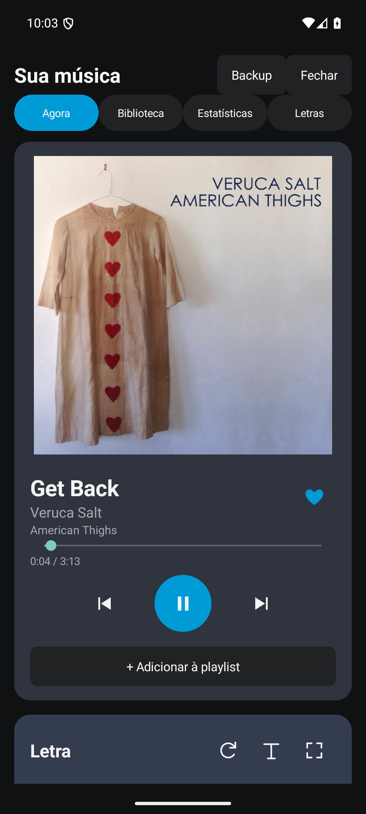

*Android 0.8.0, catálogo da sessão de validação. O cabeçalho com textos é histórico.*

## 2. Shake, Aleatório, Descoberta e fila

No álbum/playlist, os controles aparecem junto do Play. Na página da música,
também ficam abaixo do transporte. Azul indica um modo ativo.

| Ícone | Ação | Como voltar |
|---|---|---|
| Lista em movimento | **Shake:** nova ordem visual temporária a cada toque | Segurar restaura a original |
| Setas cruzadas | **Aleatório:** nova sequência de reprodução | Na fila Android, segurar desliga |
| Lupa/play com + e setas | **Descoberta 2+1:** sugestões externas entre pares de originais | Na fila Android, segurar desliga |
| Lista com play | **Fila:** ver atual/próximas, preparar e aplicar prévia | Fechar abandona a confirmação da prévia |

*Windows, suíte QML 0.11.0: álbum e faixas sintéticos. Os modos alteram a ordem
temporária, sem regravar a playlist salva.*

Depois de escolher modos na página da música, confira a prévia e confirme
**Aplicar e reproduzir fila**. Preparar não interrompe o áudio; aplicar pode
recarregar a faixa atual na posição preservada. Se a faixa mudou, prepare novamente.

<table>
<tr><th>Windows: prévia</th><th>Android: fila preparada</th></tr>
<tr><td>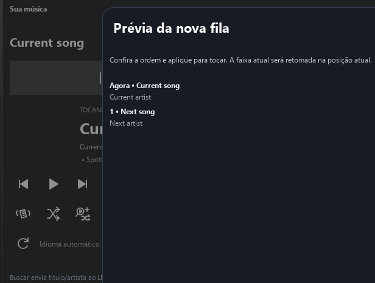</td><td>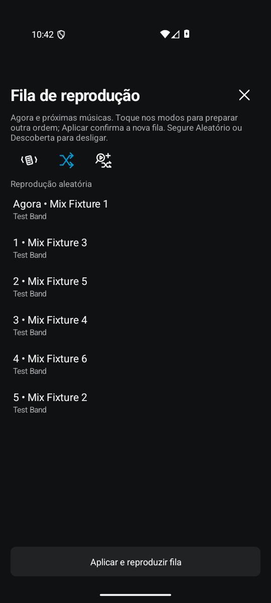</td></tr>
</table>

*Capturas de validação 0.11.0, dados sintéticos. No Android o exemplo mostra
Aleatório, não uma fila com sugestões externas reais. O Windows 0.11.1 passou
a esperar a fila atual antes de preparar essa prévia.*

A descoberta usa compatibilidade de gêneros/ano e novidade local. Não é uma
garantia de músicas inéditas: veja [todas as regras e limites](DESCOBERTA_2_MAIS_1.md).

## 3. Criar playlist colando texto

Abra **Biblioteca → Criar playlist → Criar com Text to Tonalify**.
Cole sua lista, revise as gravações e personalize nome, descrição e capa.
Resultados duvidosos pedem revisão; você pode desmarcar, trocar versão e reordenar.

<table>
<tr><th>Windows: revisar gravações</th><th>Android: mesma etapa nativa</th></tr>
<tr><td>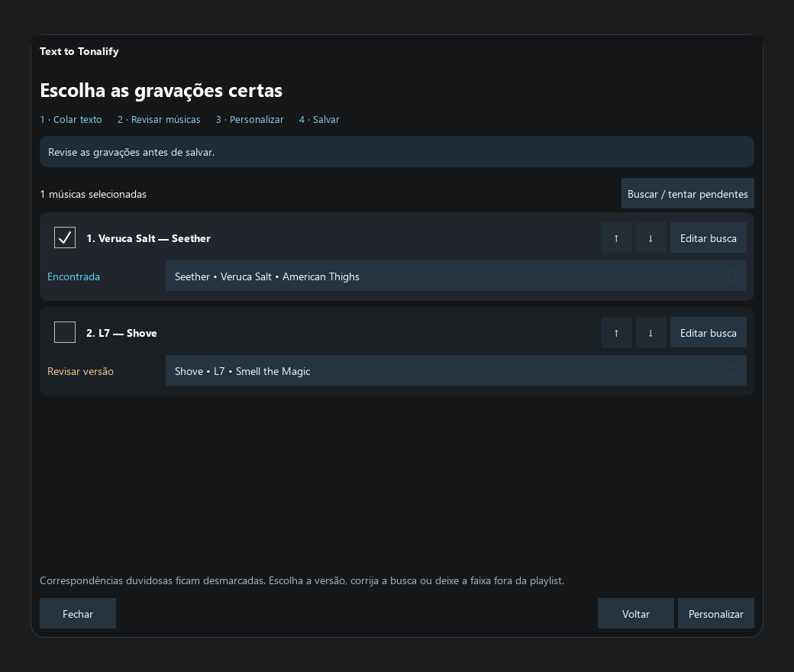</td><td>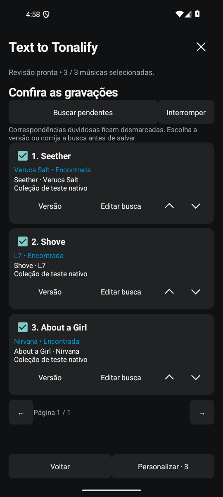</td></tr>
</table>

*Suítes QML/Android de Text to Tonalify, implementado na 0.9. Catálogos de
teste controlados; os PNGs desktop não registram um identificador do build.*

Salvar primeiro cria a playlist **neste aparelho**. Só depois você escolhe
copiar para Spotify, privada ou pública. Colar/buscar/salvar local não publica nada.

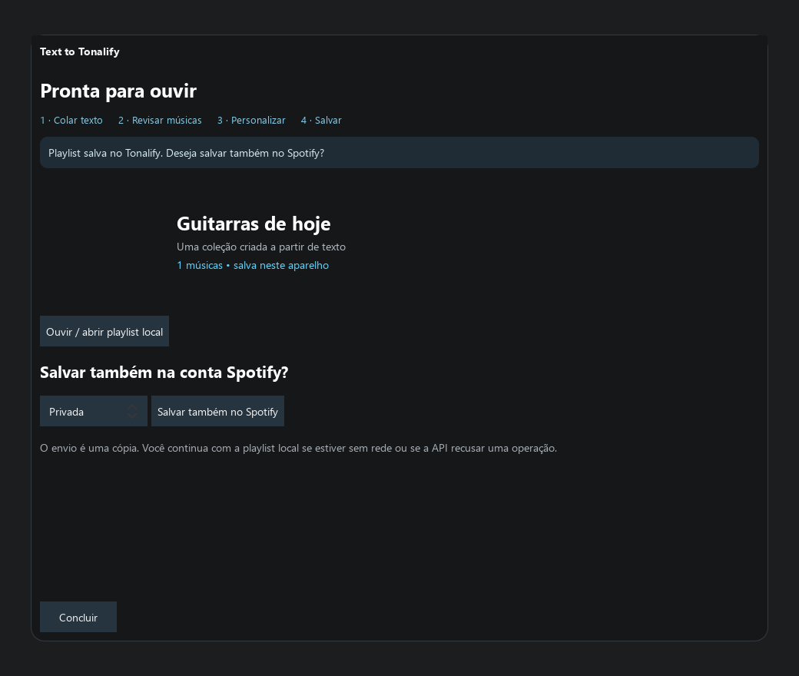

*Captura QML com playlist sintética. Essa tela não comprova envio na conta real.*

[Passo a passo completo, permissões e retomada de envio](TEXT_TO_TONALIFY_090.md).

## 4. Letras, tradução e apresentação

Abra **Letras** ou a seção Letra na página da música. Mantendo-a aberta, a
busca acompanha a troca de faixa. A tradução pt-BR usa idioma detectado
automaticamente e aparece junto das linhas originais. Não é necessário sair
do player. Falta de letra/tradução é informada, sem inventar conteúdo.

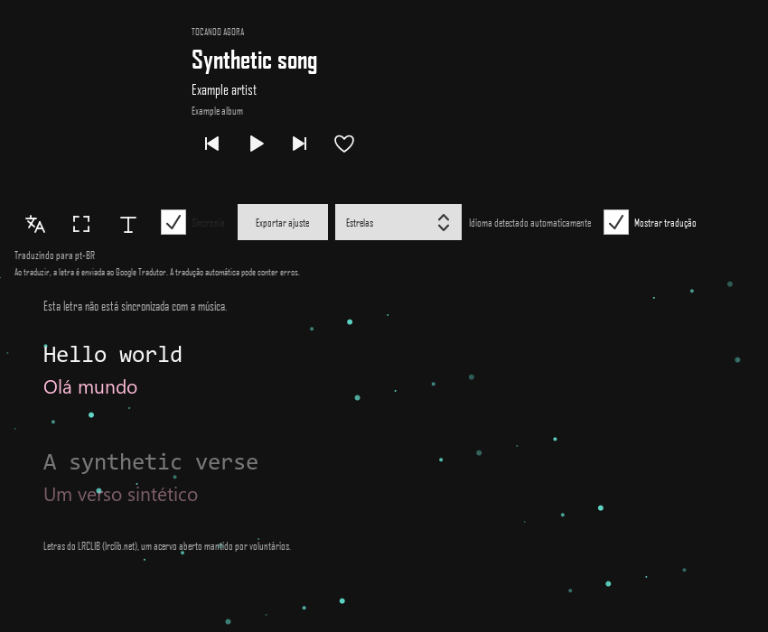

*Tela QML real, letra/tradução sintéticas. Não é uma medição do serviço externo.
O estilo de fontes/controles corresponde ao ambiente da suíte.*

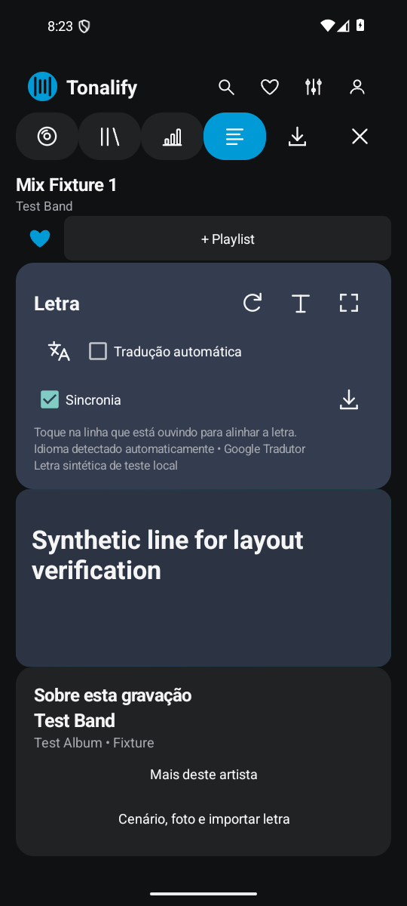

*Android 0.11.0, letra sintética. Ícones: seta circular atualiza; T personaliza;
cantos expandem; símbolo de idiomas traduz; seta para baixo exporta o ajuste.*

- Desmarque **Sincronia** para desativar o destaque que acompanha a música.
- Toque na linha que está ouvindo para alinhar a letra, sem buscar outra posição do áudio.
- Em tela cheia, **primeiro toque mostra os controles**. Com eles visíveis,
  tocar numa linha alinha e os recolhe. Rolagem não deve alinhar.
- Personalize fontes, cores, tamanho e estilos da letra e da tradução
  separadamente. Há contorno, brilho/neon, piscante, negrito, itálico e sublinhado.
- Cenários: Aurora, Ondas, Espectro, Capa, Foto, Estrelas, Chuva, Órbitas,
  Pulso, Grade e Sem animação. Ondas/Espectro usam PCM; os outros são decorativos.

Busca e tradução dependem dos provedores. Exportar o ajuste gera um arquivo
local, sem enviar automaticamente um feedback ao LRCLIB. Animação tem custo
de CPU/GPU; **Sem animação** é a opção mais econômica.

## 5. Estatísticas e clima do repertório

Abra o gráfico de **Estatísticas**, escolha período e dimensão. Toque numa
barra para detalhar tempo ouvido, escutas qualificadas, músicas distintas e
álbuns. Nas páginas de artista/álbum, o ícone de gráfico mostra/oculta resumos.

<table>
<tr><th>Artista com estatísticas nas faixas</th><th>Histórico por período</th></tr>
<tr><td>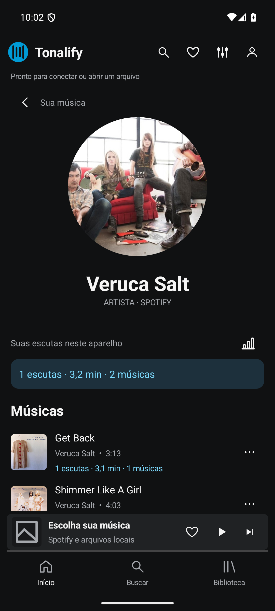</td><td>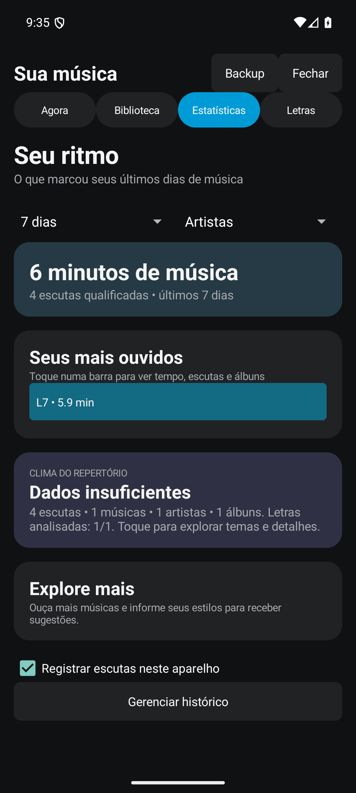</td></tr>
</table>

*Android 0.8.0. Contagens pertencem às sessões de validação; não são totais
completos da conta Spotify. O cabeçalho com texto é anterior aos ícones atuais.*

Toque no card **Clima do repertório** para temas, cobertura, artistas,
álbuns e estilos. É uma interpretação experimental das músicas, não um
diagnóstico do seu estado emocional. Com pouca evidência, mostra a limitação.

<table>
<tr><th>Windows: temas e cobertura</th><th>Android: detalhes e estilos</th></tr>
<tr><td>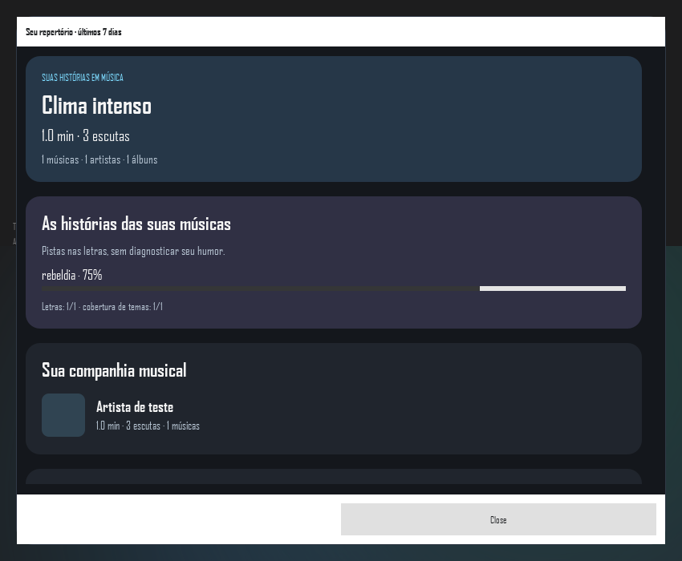</td><td>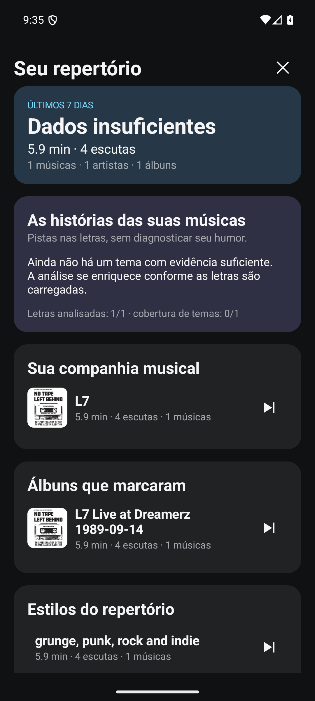</td></tr>
</table>

*Windows: dados/escores sintéticos da suíte QML. Android: sessão limitada 0.8.0.
Nenhuma captura estabelece precisão temática em letras reais.*

## 6. Raridades no IndieTonal e áudio no Android

No IndieTonal, pesquise artista e selecione a fonte. Shows, demos e gravações
dependem do que o acervo disponibiliza. O resultado informa a procedência;
abra a coleção para ver faixas públicas. MusicBrainz é discografia, sem áudio.

No Tonalify/IndieTonal, abra **Áudio/efeitos** para equalização e saída. No
Android, escolha perfil do dispositivo e buffer. Comece com Carro/Original/Flat
para comparar volume e dinâmica sem HRTF ou compressor.

<table>
<tr><th>IndieTonal: show raro de L7</th><th>Perfis de saída e buffer</th></tr>
<tr><td>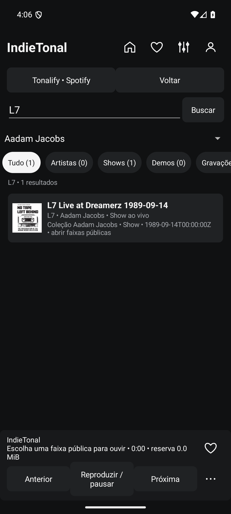</td><td>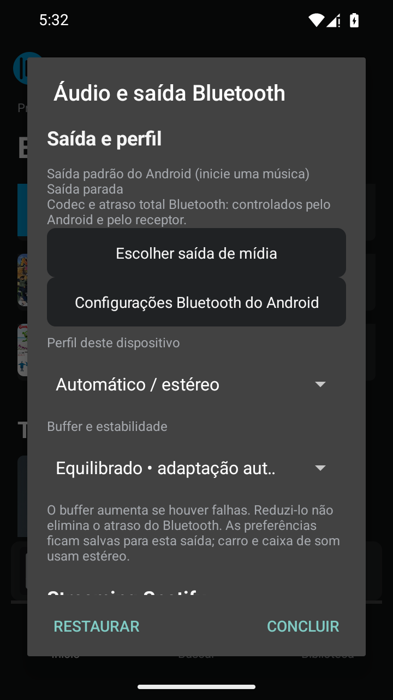</td></tr>
</table>

*Capturas históricas 0.5.0 e 0.3.0. A disponibilidade do show não foi reconsultada
para este guia. Não há carro/fone físico conectado na captura de áudio.*

DSP e buffer do app não controlam codec/atraso interno do receptor Bluetooth.
Na 0.11.1, retomar por Bluetooth/tela bloqueada após pausa exige habilitar a
opção correspondente em Áudio; áudio já iniciado continua ao bloquear a tela.

## 7. Guarde seus dados

Use **Backup → Exportar** e salve o arquivo fora dos dados internos do app.
Para restaurar/trocar de aparelho, use Importar. Desinstalar pode apagar o
banco local. Conta Spotify não é backup das estatísticas e preferências locais.
Os backups não levam senha/token nem os áudios das músicas.

O [backup privado de entrega](https://drive.google.com/drive/folders/1sNjL35fdHzoLY8QcqtBX2XF4YQJbeKlL)
também guarda fontes, histórico Git, instaláveis e documentos. O banco do
telefone físico precisa ser exportado no próprio telefone.

Original Tonal: **Matheus Nunes (natheus)**,
[projeto original](https://github.com/natheus/tonal-player). Imagens de catálogo
pertencem aos respectivos titulares; os PNGs preservam as telas registradas,
sem edição do conteúdo para simular funcionalidades.

## 8. Descobertas preservadas e análise de letras — 0.12.0

Na Fila, Shake e Aleatório preservam as músicas azuis marcadas como Descoberta.
Reabrir a janela mantém o estado confirmado. Apenas desligar Descoberta remove
as próximas externas na prévia; Aplicar confirma. A música atual continua.
A caixa de análise permite interromper a busca de letras das candidatas; os
resultados refinam preparações futuras, sem alterar a fila já confirmada.

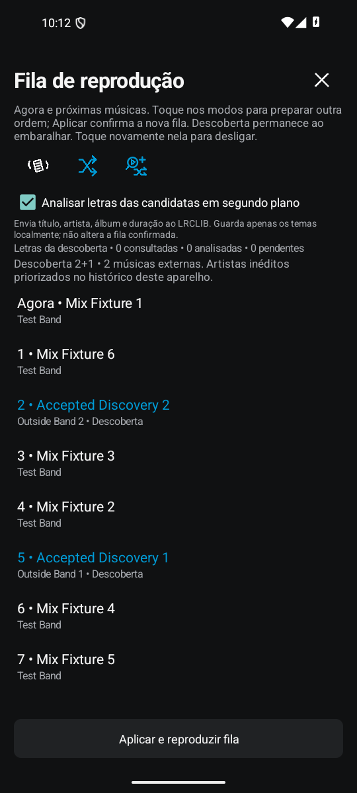
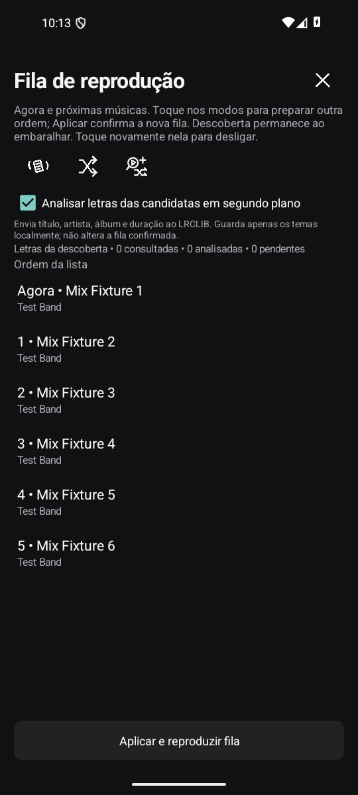

*Android 0.12.0: APK benchmark em AVD, nomes sintéticos. Prévia sem iniciar
reprodução ou escrever em playlists reais. [Relatório dos testes](discovery-enrichment-0120-tests.json).*

## 9. Temas, barra de progresso e marcador — 0.13.0

No PC, abra o menu da conta (avatar) e escolha **Temas**; no Android,
**Conta → Temas**. Cada cartão mostra as cores e a barra com o marcador
daquele tema. O clique aplica na hora e a música continua tocando.

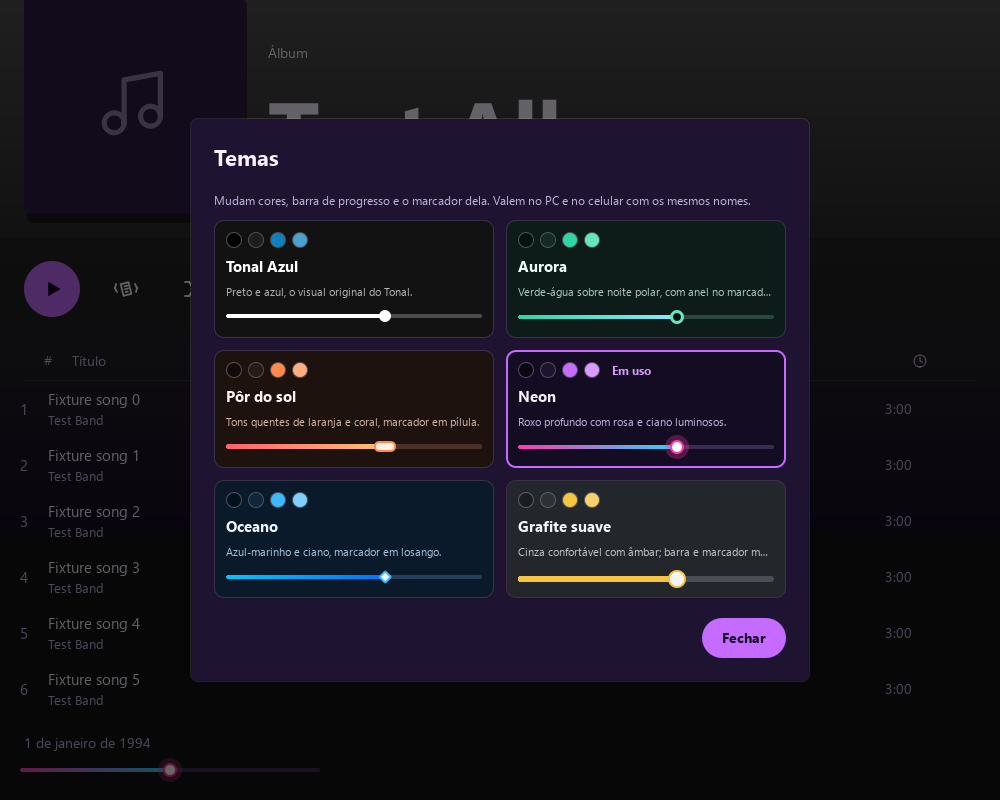

*Windows 0.13.0: suíte QML com álbum sintético; o Neon está em uso e já
tinge a página ao fundo.*

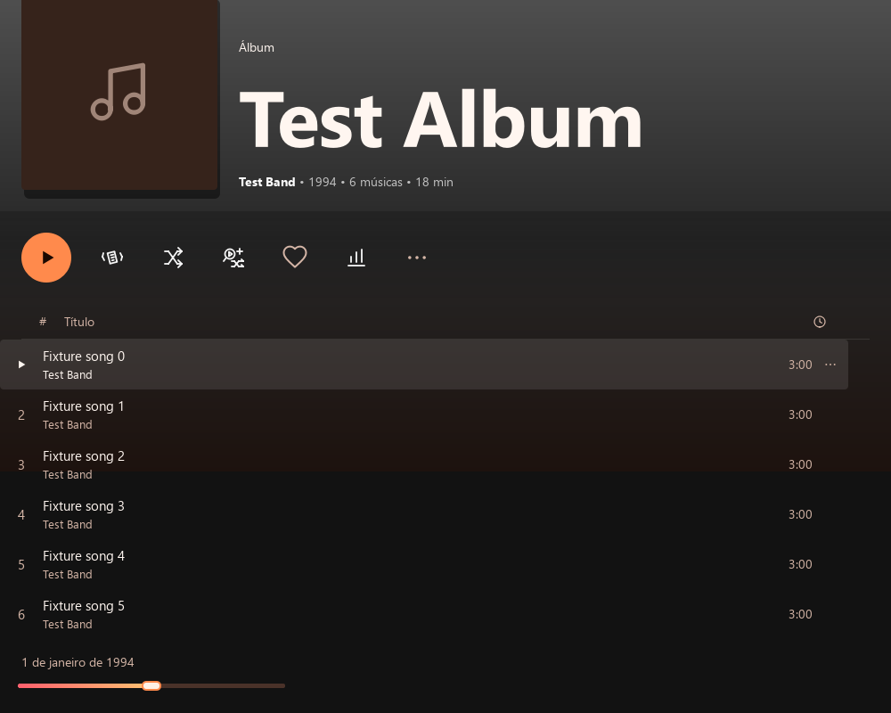

*Windows 0.13.0: mesma página sintética no tema Pôr do sol; capa ausente intencional.*

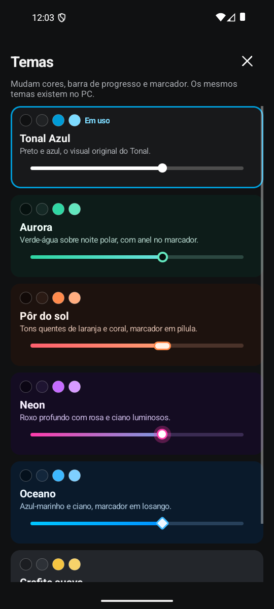
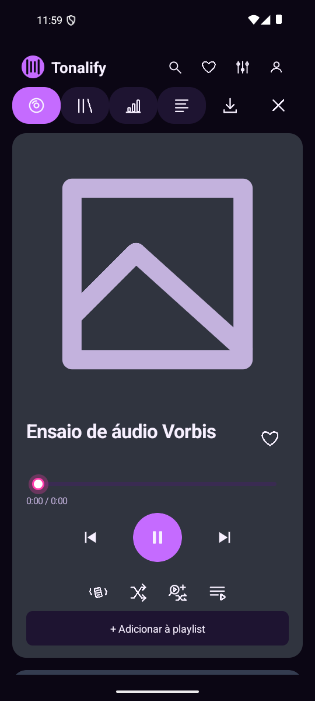

*Android 0.13.0: APK benchmark na AVD dedicada, durante o áudio de ensaio
local do próprio APK, sem conta. O PCM seguiu avançando, sem underruns, em
cada troca. [Mudanças e testes](TEMAS_SEEK_FILA_0130.md).*
